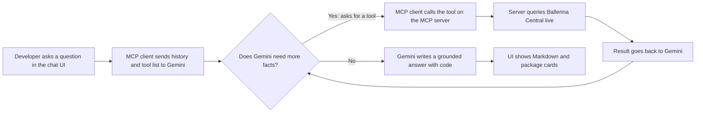
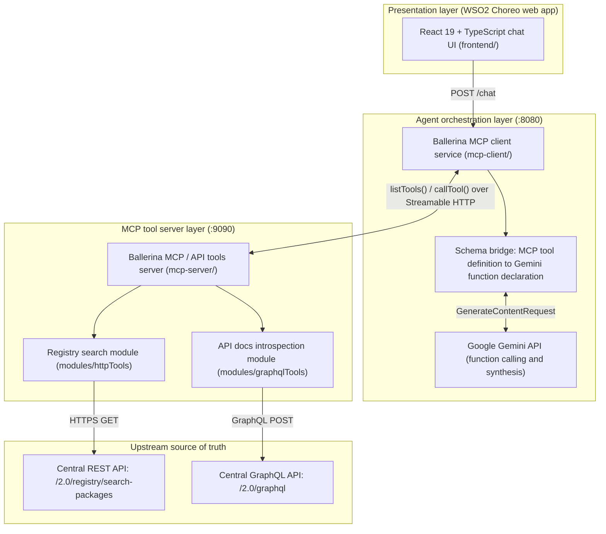
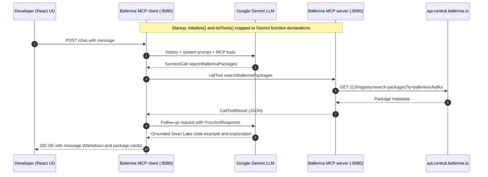

# Ballerina Central AI Mode: Asking a Package Registry Questions Without RAG

*A chat assistant that answers questions about Ballerina packages by looking at the live registry every time, instead of memorising a stale copy of it.*

## TL;DR

- I built a conversational assistant for [Ballerina Central](https://central.ballerina.io/), the package registry for the Ballerina language. It answers questions about packages, classes, methods and API signatures.
- It does **not** use Retrieval-Augmented Generation (RAG) or a vector database. Google Gemini calls typed tools (via the Model Context Protocol) that query Central's live REST and GraphQL APIs on demand.
- Three small services make it up: a React chat UI, a Ballerina MCP client that talks to Gemini, and a Ballerina MCP server that talks to the registry.
- Everything runs locally with three commands, and each service deploys as its own WSO2 Choreo component.

## The problem

Imagine asking a colleague, "How do I send messages with the Kafka package?" A good colleague would open the registry, look up the latest version, check what the client class offers, and then answer. A bad one would answer from a printout they made six months ago.

Most AI assistants for documentation are the second kind. A package registry changes constantly: new versions ship, method signatures evolve, flags get deprecated. An assistant built on a snapshot of the docs will confidently describe things that no longer exist, or miss things that were added last week.

The usual fix is RAG: chop the documentation into chunks, turn each chunk into numbers (embeddings), store them in a vector database, and fetch the closest chunks when someone asks a question. On a live registry I kept running into three problems with it:

1. **Index drift.** The embeddings fall behind new releases unless a re-ingestion pipeline runs all the time.
2. **Broken boundaries.** Chunking API reference docs can split a class away from its methods and record types, which invites hallucinated parameters.
3. **Infrastructure overhead.** Vector stores, embedding pipelines and re-rankers are a lot to maintain when authoritative, structured REST and GraphQL endpoints already exist.

## The idea

Don't memorise the library. Give the assistant a library card.

Instead of copying the registry into a database, I let the AI ask the registry directly, the way a developer would: search for a package, open its page, list its functions, then drill into one class. Each of those actions is a **tool** with a clear name and clear inputs. The model decides which tool to call, reads the live answer, and writes a response grounded in what it just saw.

> **Glossary**
> - **LLM:** the large language model (here, Google Gemini) that writes the answers.
> - **Function calling:** a feature where the model, instead of answering, asks the app to run a named function and hand back the result.
> - **MCP (Model Context Protocol):** an open standard for describing tools to an AI so any compatible client can discover and use them.
> - **RAG:** retrieval from a pre-built index of documents. Not used here.

## How it works



In plain English:

1. You type a question, for example "How do I send messages with ballerinax/kafka?"
2. The chat UI sends it to the orchestrator service, along with the conversation so far.
3. The orchestrator hands Gemini the question plus a menu of available tools.
4. Gemini replies, "Please run `searchBallerinaPackages` with `ballerinax/kafka`."
5. The orchestrator runs that tool on the tool server, which asks Ballerina Central and returns real package data.
6. Gemini reads the result, may ask for more (for example class details), and finally writes an answer with a code example based on what the registry actually says.

> **For the curious:** the "menu of tools" is not hard-coded in the client. At startup the client initialises an MCP session and calls `listTools()`, then converts each MCP tool definition into a Gemini function declaration. Adding a tool to the server makes it available to the model with no client changes.

## Under the hood

### Architecture



### One request, step by step



### The five tools

The server exposes five granular introspection tools. Search uses Central's REST API; the other four use its GraphQL API.

| Tool | Upstream | Inputs | What it returns |
| :--- | :--- | :--- | :--- |
| `searchBallerinaPackages` | REST `/2.0/registry/search-packages` | `searchQuery`, `offset`, `limit`, `sort` | Matching packages with organization, name, latest version, summary, keywords and URL. Supports `org:`, `package:`, `keyword:` qualifiers |
| `getBallerinaPackageDetails` | GraphQL `/2.0/graphql` | `orgName`, `moduleName`, `version` | README overview, release metadata, exported module list |
| `getAllModuleFunctions` | GraphQL `/2.0/graphql` | `orgName`, `moduleName`, `version` | Public functions with parameter types and return signatures |
| `getAllModuleClasses` | GraphQL `/2.0/graphql` | `orgName`, `moduleName`, `version` | Exported client and service classes (such as `Client`, `Listener`) |
| `getDetailedClassInformation` | GraphQL `/2.0/graphql` | `orgName`, `moduleName`, `version`, `className` | A single class in depth: `init` config records, `remote` methods, fields and docstrings |

The tools are deliberately small and ordered from broad to narrow. The model can zoom in the way a person would: find the package, list its classes, then open the one it needs.

### Key design decisions

- **Live tools instead of an index.** The registry is the source of truth, so there is nothing to re-ingest and nothing to go stale. The trade-off is that every answer needs network round trips to Central, so it is slower than a local vector lookup, and it depends on Central being up.
- **Structured data instead of text chunks.** GraphQL returns a class together with its methods and config records, so the model sees whole definitions rather than fragments. This addresses the "broken boundaries" problem directly.
- **MCP between the orchestrator and the tools.** Separating "who talks to the model" from "who talks to the registry" keeps each Ballerina service small. The schema bridge in the client means tools are discovered at runtime instead of wired by hand.
- **Three independent services.** Each one is its own Choreo component, so they deploy and scale separately. The cost is more moving parts than a single app.

> **For the curious:** the orchestrator's tool loop is multi-turn. After each tool result it sends a follow-up request to Gemini, which may request another tool or produce the final text. The loop lives in `mcp-client/modules/tools`, and a typed Gemini client lives in `mcp-client/modules/gemini`.

### Monorepo layout

```text
ballerina-central-ai/
├── frontend/                  # React 19 + TypeScript + Vite chat app
│   ├── public/config.example.js
│   └── src/
│       ├── api/               # Axios client and chat request types
│       └── components/        # ChatView, ChatMessageList, PackageCard, LandingPage
├── mcp-client/                # Ballerina MCP host and Gemini orchestrator (:8080)
│   ├── service.bal            # POST /chat and GET /health, MCP initialization
│   ├── Config.example.toml    # geminiAPIKey, geminiModel, mcpEndpoint
│   └── modules/
│       ├── gemini/            # Typed client for the Generative Language API
│       └── tools/             # MCP to Gemini schema converter and tool loop
└── mcp-server/                # Ballerina registry and API-docs tool server (:9090)
    ├── service.bal
    └── modules/
        ├── httpTools/         # REST client for package and symbol search
        └── graphqlTools/      # GraphQL queries for docs, functions and classes
```

### Tech stack

| Service | Directory | Stack | Port | Responsibility |
| :--- | :--- | :--- | :--- | :--- |
| Chat frontend | `frontend/` | React 19, TypeScript, Tailwind CSS, Vite | `5173` | Chat interface, Markdown rendering, interactive package cards |
| MCP client and orchestrator | `mcp-client/` | Ballerina Swan Lake (`ballerina/mcp`, `ballerina/http`) | `8080` | Discovers MCP tools, translates schemas to Gemini function declarations, executes tool calls |
| MCP / registry tool server | `mcp-server/` | Ballerina Swan Lake (`ballerina/http`, GraphQL) | `9090` | Queries live Central REST and GraphQL APIs |

## Results and what I learned

I don't have benchmark numbers for this project, so I won't make any up. What I can say is what the design delivers and what I took away from it:

- **Freshness comes for free.** Because the answer is built from the registry at question time, a newly published version is visible immediately, with no re-indexing step.
- **Whole definitions beat fragments.** Handing the model complete class and method data reduced my worry about invented parameters, since the signatures it cites come from the registry itself.
- **Tool design matters more than prompt tricks.** Five small, well-named tools that go from broad to narrow gave the model a natural path to follow.
- **RAG is not always the right default.** When a trustworthy structured API already exists, calling it directly can be simpler than building a retrieval pipeline.

## Try it yourself

**Prerequisites**

- Ballerina Swan Lake 2201.10.x or newer ([install](https://ballerina.io/downloads/))
- Node.js 20+ and `npm`
- A Google Gemini API key from [Google AI Studio](https://aistudio.google.com/)

**1. Start the tool server (`:9090`)**

```bash
cd mcp-server
bal run
```

**2. Configure and start the MCP client (`:8080`)**

```bash
cd mcp-client
cp Config.example.toml Config.toml
# Edit Config.toml with your geminiAPIKey, geminiModel, and mcpEndpoint
bal run
```

Check that it is ready:

```bash
curl http://localhost:8080/health
```

**3. Launch the chat frontend (`:5173`)**

```bash
cd frontend
cp public/config.example.js public/config.js
npm install
npm run dev
```

### Deploying to WSO2 Choreo

Each directory is an independent Choreo component:

1. Deploy `mcp-server/` as an **Internal Service** component.
2. Deploy `mcp-client/` as a **Service** component, binding `geminiAPIKey`, `geminiModel` and `mcpEndpoint` through Choreo Config and Secrets.
3. Deploy `frontend/` as a **Web Application** component, mounting `config.js` with the Choreo-managed gateway URL for `mcp-client`.

## What's next and limitations

- Every question depends on the live Central APIs and on Gemini, so outages or rate limits on either side affect answers.
- The assistant only knows what the five tools can see. Questions outside package, class and function metadata are out of scope.
- Live calls add latency compared with a local index. Caching frequently requested package data is a natural next step, though it would reintroduce a little of the staleness this project avoids.

## Links

- Repository: [AbQaadir/ballerina-central-ai](https://github.com/AbQaadir/ballerina-central-ai)
- Demo walkthrough: [Watch on Google Drive](https://drive.google.com/file/d/19DKHcLbWPylLvu_BmufW6I74PawIdU3C/view?usp=sharing)
- [Ballerina Central](https://central.ballerina.io/), [Model Context Protocol](https://modelcontextprotocol.io/), [WSO2 Choreo](https://wso2.com/choreo/)
- License: MIT
