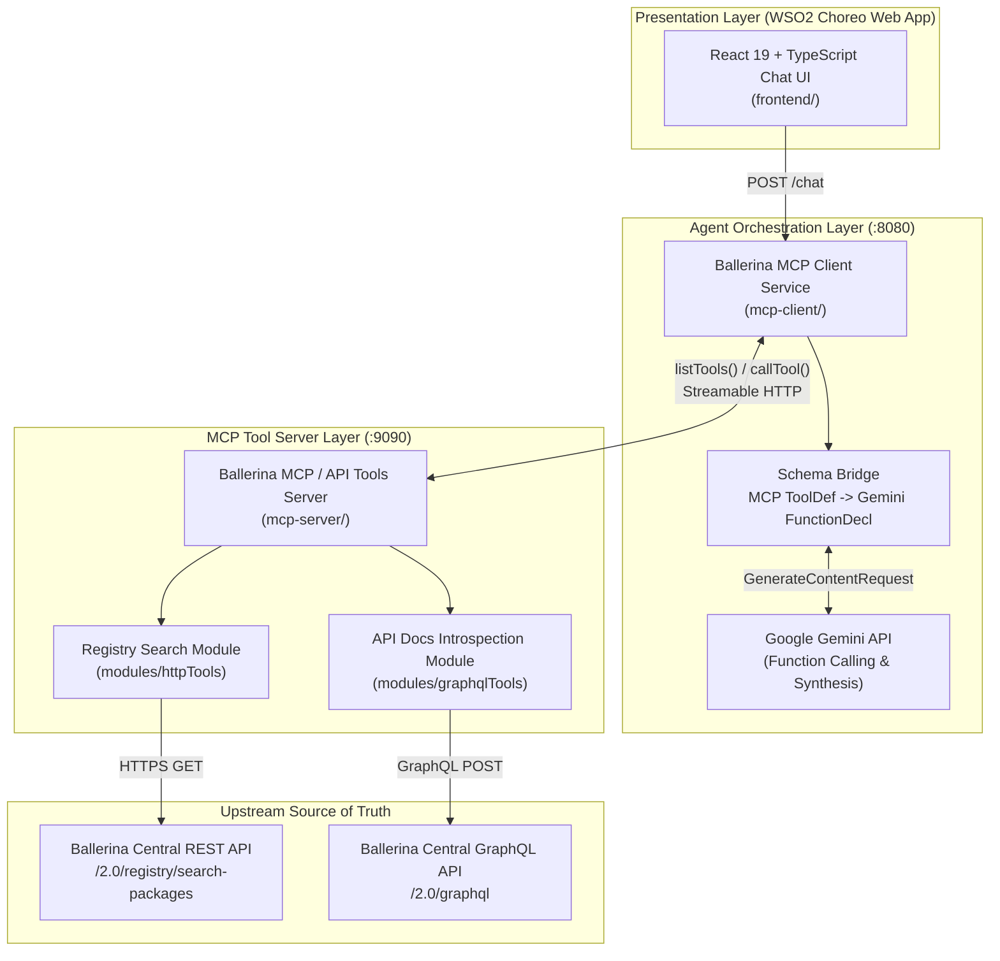
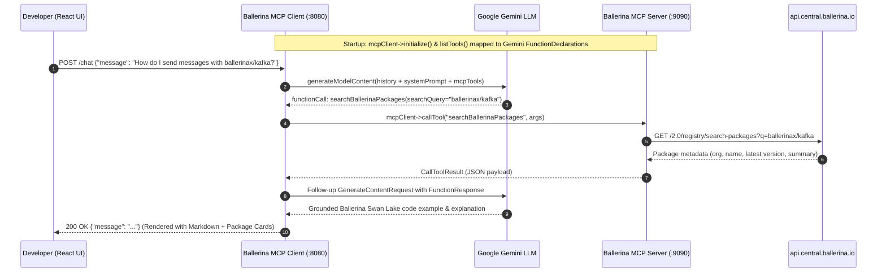

# Ballerina Central AI Mode — Zero-RAG Conversational Package Discovery via MCP

[](https://ballerina.io/)
[](https://modelcontextprotocol.io/)
[](https://ai.google.dev/)
[](https://react.dev/)
[](https://wso2.com/choreo/)
[](LICENSE)

**Ballerina Central AI Mode** is a full-stack conversational AI assistant for [Ballerina Central](https://central.ballerina.io/) that answers developer questions about Ballerina packages, modules, client classes, remote methods, and API signatures in real time—**without relying on Retrieval-Augmented Generation (RAG) or vector databases**.

Instead of indexing static documentation snapshots that go stale every time a package author publishes a new semver release, the assistant pairs **Google Gemini Function Calling** with a **Ballerina Model Context Protocol (MCP) Client & Server** that queries Ballerina Central's live REST and GraphQL APIs on demand.

---

## Why Live MCP Tool-Calling Over Static RAG?

Package registries mutate continuously: new connector versions ship daily, method signatures evolve, and deprecated flags change. Traditional chunk-and-embed RAG pipelines suffer from three structural failure modes on live package registries:

1. **Index Drift**: Vector embeddings lag behind newly published package versions unless re-ingestion pipelines run continuously.
2. **Broken AST Boundaries**: Chunking API reference docs splits class definitions apart from their remote methods and record type definitions, causing hallucinated parameters.
3. **Infrastructure Overhead**: Maintaining vector stores, embedding pipelines, and re-rankers adds operational cost when authoritative structured REST and GraphQL endpoints already exist.

By exposing Ballerina Central's registry search and GraphQL API-doc introspection directly as **typed MCP tools**, Gemini dynamically discovers packages, inspects exact module functions/classes, and synthesizes grounded code examples against live registry metadata.

---

## System Architecture



### Request-to-Answer Sequence



---

## Monorepo Structure

This repository consolidates the three production microservices that power Ballerina Central AI Mode:

```text
ballerina-central-ai/
├── frontend/                                     # React 19 + TypeScript + Vite conversational web app
│   ├── public/config.example.js                  # Choreo runtime endpoint configuration template
│   └── src/
│       ├── api/                                  # Axios client & chat request types
│       └── components/                           # ChatView, ChatMessageList, PackageCard, LandingPage
├── mcp-client/                                   # Ballerina Swan Lake MCP Host & Gemini Orchestrator (:8080)
│   ├── service.bal                               # POST /chat & GET /health HTTP service + MCP initialization
│   ├── Config.example.toml                       # Configurable keys (geminiAPIKey, geminiModel, mcpEndpoint)
│   └── modules/
│       ├── gemini/                               # Typed Ballerina client for Google Generative Language API
│       └── tools/                                # MCP <-> Gemini schema converter & multi-turn tool loop
└── mcp-server/                                   # Ballerina Swan Lake Registry & API-Docs Tool Server (:9090)
    ├── service.bal                               # Tool endpoints exposing package & symbol introspection
    └── modules/
        ├── httpTools/                            # REST client for Ballerina Central package/symbol search
        └── graphqlTools/                         # GraphQL queries for package docs, functions & classes
```

| Service | Directory | Runtime & Stack | Default Port | Responsibility |
| :--- | :--- | :--- | :--- | :--- |
| **Chat Frontend** | `frontend/` | React 19, TypeScript, Tailwind CSS, Vite | `5173` | Conversational interface, Markdown rendering, interactive package cards |
| **MCP Client & Orchestrator** | `mcp-client/` | Ballerina Swan Lake (`ballerina/mcp`, `ballerina/http`) | `8080` | Discovers MCP tools dynamically, translates schemas to Gemini function declarations, executes tool calls |
| **MCP / Registry Tool Server** | `mcp-server/` | Ballerina Swan Lake (`ballerina/http`, GraphQL) | `9090` | Queries live `api.central.ballerina.io` REST & GraphQL APIs without RAG |

---

## Exposed Registry & Introspection Tools

The tool server (`mcp-server/`) exposes five granular introspection capabilities over Ballerina Central:

| Tool Name | Upstream API | Input Parameters | Returned Context |
| :--- | :--- | :--- | :--- |
| `searchBallerinaPackages` | REST `/2.0/registry/search-packages` | `searchQuery`, `offset`, `limit`, `sort` | Matching packages with `organization`, `name`, latest `version`, `summary`, `keywords`, and `URL` (supports `org:`, `package:`, `keyword:` qualifiers) |
| `getBallerinaPackageDetails` | GraphQL `/2.0/graphql` | `orgName`, `moduleName`, `version` | Package-level README overview, release metadata, and exported module list |
| `getAllModuleFunctions` | GraphQL `/2.0/graphql` | `orgName`, `moduleName`, `version` | Complete list of public functions in the module with parameter types and return signatures |
| `getAllModuleClasses` | GraphQL `/2.0/graphql` | `orgName`, `moduleName`, `version` | Exported client & service classes (e.g., `Client`, `Listener`) defined in the module |
| `getDetailedClassInformation` | GraphQL `/2.0/graphql` | `orgName`, `moduleName`, `version`, `className` | Deep inspection of a specific class, including `init` config records, `remote` methods, fields, and docstrings |

---

## Local Development Setup

### Prerequisites
- **Ballerina Swan Lake** (2201.10.x or newer) — [Install Ballerina](https://ballerina.io/downloads/)
- **Node.js** 20+ & `npm`
- **Google Gemini API Key** — [Google AI Studio](https://aistudio.google.com/)

### 1. Start the Ballerina Tool Server (`:9090`)

```bash
cd mcp-server
bal run
```

### 2. Configure & Start the Ballerina MCP Client (`:8080`)

```bash
cd mcp-client
cp Config.example.toml Config.toml
# Edit Config.toml with your geminiAPIKey, geminiModel, and mcpEndpoint
bal run
```

Verify readiness via the health endpoint:

```bash
curl http://localhost:8080/health
```

### 3. Launch the React Chat Frontend (`:5173`)

```bash
cd frontend
cp public/config.example.js public/config.js
npm install
npm run dev
```

---

## WSO2 Choreo Cloud Deployment

Each directory is structured as an independent **WSO2 Choreo** component:
1. Deploy `mcp-server/` as an **Internal Service Component** in Choreo.
2. Deploy `mcp-client/` as a **Service Component**, binding `geminiAPIKey`, `geminiModel`, and `mcpEndpoint` via Choreo Config & Secrets.
3. Deploy `frontend/` as a **Web Application Component**, mounting `config.js` with the Choreo-managed gateway URL for `mcp-client`.

---

## Demo

- **Walkthrough Video**: [Watch Demo on Google Drive](https://drive.google.com/file/d/19DKHcLbWPylLvu_BmufW6I74PawIdU3C/view?usp=sharing)

---

## License

Released under the [MIT License](LICENSE).
